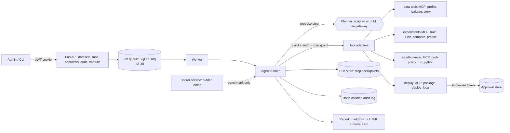

# junior-ml-dev

A junior ML engineer that shows its work and catches its own mistakes: it profiles a tabular dataset,
checks for leakage before modelling, trains and compares models against baselines, has a deterministic
reviewer sign off, and writes a report plus a model card. Deployment is gated by a single-use approval.

> **Honest status.** The agent that runs today is **scripted** (a deterministic planner, no LLM). An LLM
> planner exists behind the same interface and was exercised only with a **mock** provider; no real LLM
> was ever called. Docker, Postgres, Redis, E2B and CI were never run on the development machine.
> Two held-out agent evaluations exist (v1 headline, v2 post-hoc), both scripted-planner. Numbers are in [docs/RESULTS.md](docs/RESULTS.md), generated from `benchmarks/results/*.json`.
> What was not done, and how to resume it, is in [docs/SKIPPED.md](docs/SKIPPED.md) and
> [docs/KNOWN_GAPS.md](docs/KNOWN_GAPS.md).

## Architecture



Key properties, each backed by tests:

- **Resumable.** Every step is checkpointed; a hard-killed run resumes at the first unfinished step
  (`tests/unit/test_agent_runner.py::test_resume_after_hard_kill_matches_uninterrupted_run`).
- **Budgets.** Steps, wall time and tokens; exhaustion jumps to a bounded wrap-up and still returns the best model so far.
- **Guardrails.** Code policy, deterministic reviewer checks, untrusted-data sanitiser, and a structural action guard that does not depend on the model behaving.
- **Approvals.** Deploy needs a single-use token bound to (action, run, model); the run pauses as `awaiting_approval`.
- **Integrity.** Benchmark numbers come from code-written JSON with a conditions block; the benchmark is evaluated once per frozen hash via a ledger written before the run.

> **Sandbox warning.** The only sandbox that has run is the local subprocess backend. On Windows it
> applies job-object limits (memory, process count, kill-on-close); it is **NOT isolation** (no
> filesystem or network restriction). Docker and E2B backends exist as interfaces and are untested.

## Quick start

```bash
uv sync --group dev
uv run python scripts/demo.py            # full scripted run on a bundled dataset, offline
uv run python scripts/demo.py --deploy   # also stages an approval-gated deploy
python scripts/tasks.py lint             # ruff + mypy
python scripts/tasks.py test             # unit tests
```

Run the API (login is disabled until you set `ADMIN_PASSWORD_HASH` and `JWT_SECRET`; see `.env.example`):

```bash
uv run python -m harness.security.auth 'choose a password'   # prints the argon2 hash
uv run uvicorn apps.api.main:app
```

Re-run an agent from the CLI (re-running the same command resumes after a crash):

```bash
uv run python -m harness.agent.cli run --config run.json --db data/runs.db
```

## Layout

| Path | What |
|---|---|
| `leakage/`, `datastory/` | Leakage Detective v1, profiling, quality scorecard, claim verifier |
| `mcp_servers/{data_tools,experiments,deploy,sandbox_exec}` | The four MCP servers (official SDK, stdio) |
| `harness/agent/` | Planners, runner, run store, report, tool adapters |
| `harness/{gateway,policies,review,sandbox,security}` | LLM gateway, code policy, reviewer checks, sandbox backends, approvals, audit, auth |
| `harness/queue.py` | Job queue interface (SQLite; arq is a STUB) |
| `apps/{api,scorer}` | FastAPI app; scorer service holding hidden labels |
| `benchmarks/` | Tasks, baselines, agent dev + benchmark, injection suite, results JSONs |
| `docs/` | Decisions, ADRs, results, gaps, skipped items, autopilot report |

Plan: `PRD.md`. Decisions: `docs/DECISIONS.md`, `docs/adr/`. Reproduce a number: `docs/RESULTS.md` names the file and the command is inside it.
