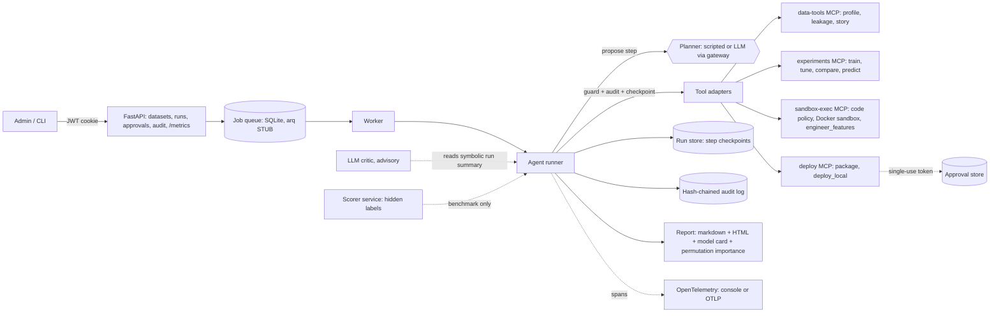

# junior-ml-dev

A junior ML engineer that shows its work and catches its own mistakes: it profiles a tabular dataset,
checks for leakage before modelling, trains and compares models against baselines, has a deterministic
reviewer sign off, and writes a report plus a model card. Deployment is gated by a single-use approval.


> **Status (honest).** Two planners: a **scripted** one (deterministic, no LLM) and an **LLM** one
> (Groq gpt-oss, Gemini fallback; cloud APIs only, capped at 120 requests/day per provider and 1 per
> 2 s). Headline = **v5**: 10 unseen OpenML tasks, each arm run once from the frozen tag
> `agent-frozen-v5`. Normalized score (FLAML = 1): scripted 0.987, LLM planner 0.989 (95% CIs in
> [docs/METRICS.md](docs/METRICS.md)); both beat the linear baseline (0.798) by about 0.19 and neither
> is distinguishable from FLAML. Leakage detector v3: 29/30 planted bugs found on an unseen
> partition, 0/30 false alarms on clean twins. Real-LLM prompt-injection rerun: 0/49 attacker actions
> proposed, 0 unsafe executed (run-6 payload sets); a fresh 14-payload evasion set also produced 0 attacker actions proposed (Wilson upper bound 21.5%), and the scanner flagged only 1 of those 14, so the structural guard and the model's own behaviour carry the result. Every number is generated from `benchmarks/results/*.json` or a CI run:
> [docs/METRICS.md](docs/METRICS.md), [docs/RESULTS.md](docs/RESULTS.md).
>
> **Live demo:** [](https://junior-ml-dev-demo.onrender.com) https://junior-ml-dev-demo.onrender.com (sample runs only, scripted planner, no uploads; it sleeps when idle: health 32.7 s after idle, first run about 106 s, then a sample run p50 49.8 s; the free 0.1 vCPU forced FLAML off and the leakage detectors to be skipped, see [docs/ws/R.md](docs/ws/R.md)). Static precomputed examples: https://giri-harsh.github.io/junior-ml-dev-demo/ . The demo runs on Render free (0.1 vCPU, 512 MB) with FLAML and the leakage detectors disabled to meet the time limit; the full pipeline is benchmarked separately ([docs/RESULTS.md](docs/RESULTS.md)). The E2B sandbox backend ran live: 20/20 execs, total p50 1.87 s / p95 2.67 s ([docs/ws/A.md](docs/ws/A.md)).
>
> **How to verify.** Verified via local quality gate: ruff, format, mypy, pytest — 683 tests, 91.8% coverage (floor 91%). Run it with `python scripts/tasks.py gate`.
>
> **Limitations.** The S3 service in compose is a moto stand-in (MinIO not pullable), the E2B backend
> ran live once (20/20 execs, [docs/ws/A.md](docs/ws/A.md)), the local subprocess sandbox is **not** isolation, per-task differences below ~0.02
> are noise, the LLM critic is advisory (fresh planted set v2: recall 18/23, 0/30 false alarms, but 0/4 on rule-failed baseline margins; v5 agreement 18/20 is post-hoc), and load test numbers
> come from a hosted runner (errors appear at 100 users). Gaps and resume steps:
> [docs/SKIPPED.md](docs/SKIPPED.md), [docs/KNOWN_GAPS.md](docs/KNOWN_GAPS.md),
> [docs/NEEDS_HARSH.md](docs/NEEDS_HARSH.md).

## Architecture



Key properties, each backed by tests:

- **Resumable.** Every step is checkpointed; a hard-killed run resumes at the first unfinished step
  (`tests/unit/test_agent_runner.py::test_resume_after_hard_kill_matches_uninterrupted_run`).
- **Budgets.** Steps, wall time and tokens; exhaustion jumps to a bounded wrap-up and still returns the best model so far.
- **Guardrails.** Code policy, deterministic reviewer checks, untrusted-data sanitiser, and a structural action guard that does not depend on the model behaving.
- **Approvals.** Deploy needs a single-use token bound to (action, run, model); the run pauses as `awaiting_approval`.
- **Integrity.** Benchmark numbers come from code-written JSON with a conditions block; the benchmark is evaluated once per frozen hash via a ledger written before the run.

> **Sandbox warning.** The only sandbox that has run is the local subprocess backend. On Windows it
> applies job-object limits (memory, process count, kill-on-close); it is **NOT isolation** (no
> filesystem or network restriction). The E2B backend (per-exec microVM, no network) ran live in run 8; the Docker backend is exercised by the **infra** workflow.

## Quick start

```bash
uv sync --group dev
uv run python scripts/demo.py            # full scripted run on a bundled dataset, offline
uv run python scripts/demo.py --deploy   # also stages an approval-gated deploy
python scripts/tasks.py lint             # ruff + mypy
python scripts/tasks.py test             # unit tests
```

Run the API (login is disabled until you set `ADMIN_PASSWORD_HASH` and `JWT_SECRET`; see `.env.example`):

```bash
uv run python -m harness.security.auth 'choose a password'   # prints the argon2 hash
uv run uvicorn apps.api.main:app
```

Re-run an agent from the CLI (re-running the same command resumes after a crash):

```bash
uv run python -m harness.agent.cli run --config run.json --db data/runs.db
```

## Layout

| Path | What |
|---|---|
| `leakage/`, `datastory/` | Leakage Detective v1, profiling, quality scorecard, claim verifier |
| `mcp_servers/{data_tools,experiments,deploy,sandbox_exec}` | The four MCP servers (official SDK, stdio) |
| `harness/agent/` | Planners, runner, run store, report, tool adapters |
| `harness/{gateway,policies,review,sandbox,security}` | LLM gateway, code policy, reviewer checks, sandbox backends, approvals, audit, auth |
| `harness/queue.py` | Job queue interface (SQLite; arq is a STUB) |
| `apps/{api,scorer}` | FastAPI app; scorer service holding hidden labels |
| `benchmarks/` | Tasks, baselines, agent dev + benchmark, injection suite, results JSONs |
| `docs/` | Decisions, ADRs, results, gaps, skipped items, autopilot report |

Plan: `PRD.md`. Decisions: `docs/DECISIONS.md`, `docs/adr/`. Reproduce a number: `docs/RESULTS.md` names the file and the command is inside it.
